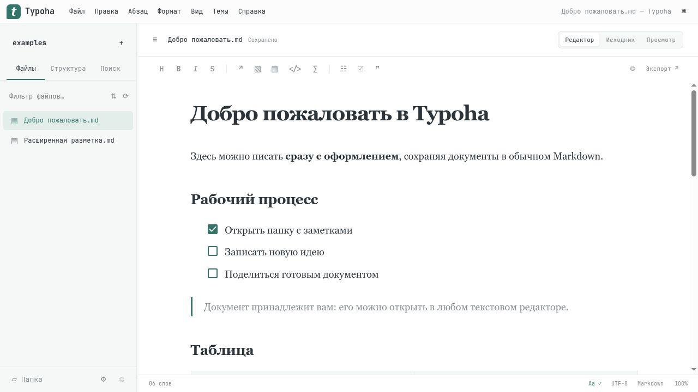

# Typoha

[English](README.md) | **Русский**

Typoha вдохновлена подходом Typora к спокойному редактированию Markdown, но развивается в собственном направлении: со своим интерфейсом и независимой реализацией. Проект не связан с разработчиками Typora.

Новый запуск открывает минималистичную вкладку с кнопками «Открыть файл» и «Открыть папку», без автоматического вызова проводника. Вкладки: Ctrl+T / Ctrl+W. Настройки: Ctrl+, — пять категорий, предпросмотр тем, собственные цвета и управление анимациями.

Самостоятельный локальный Markdown-редактор: файловое ядро на **Rust**, интерфейс на **TypeScript** с Milkdown и CodeMirror. Собственные стили, тексты и примеры; код и ресурсы Typora не используются.

**Версия 0.1.0 — рабочая начальная реализация, не полный клон 1:1.** Подробная [таблица покрытия и отличий](docs/parity.md) перечисляет готовые функции и оставшуюся работу. Метод независимой реализации описан в [clean-room.md](docs/clean-room.md).

**Проект навайбкоден:** создан с помощью ИИ-агентов для программирования (Codex) под руководством владельца проекта.



## Запуск

Из папки проекта:

```bash
./run.sh
```

При наличии готовой сборки откроется пустая стартовая вкладка. Если сборки ещё нет, скрипт соберёт её; нужны Node.js 24+, npm, rustup и C/C++ linker. Версия Rust закреплена в `rust-toolchain.toml`. Первая сборка загружает открытые зависимости из npm/crates.io.

Открыть свою папку:

```bash
./run.sh /полный/путь/к/заметкам
```

Откроется отдельное окно **Typoha** со встроенным Electron/Chromium: установленный браузер не нужен. Выбор папки — системный диалог, экспорты сохраняются через диалог выбора файла, PDF создаётся напрямую. Закрытие окна останавливает локальное файловое ядро; при несохранённых изменениях можно отменить закрытие. Русский и английский словари поставляются локально, без сетевой загрузки при запуске.

Для явного запуска в браузере используйте `./run.sh --browser /путь/к/заметкам`. Режим сервера для разработки:

```bash
./run.sh ./examples --no-open --port 43217
```

Сервер привязан только к `127.0.0.1`. Ссылка из терминала содержит временный ключ доступа; не публикуйте её. В режиме сервера Ctrl+C останавливает процесс, закрытие вкладки его не останавливает.

Linux-дистрибутив с оболочкой создаётся в `artifacts/typoha-0.1.0-linux-x86_64-desktop/`: запустите `./typoha`, затем откройте файл или папку со стартовой вкладки. Node, Rust и установленный браузер пользователю не нужны. `./install-menu.sh` добавляет Typoha в меню приложений для текущего пользователя; после этого не перемещайте распакованную папку. Electron требует обычных графических библиотек Linux и работающей песочницы Chromium; песочница автоматически не отключается.

Язык интерфейса приложения пока русский. Этот README описывает текущую версию.

## Уже работает

- Живое Markdown-редактирование, исходник, предпросмотр; таблицы и списки задач.
- Формулы KaTeX, Mermaid, подсветка кода; сноски, alerts, emoji, индексы и выделение в предпросмотре.
- Дерево файлов, структура документа, поиск/замена, regex-поиск по папке и быстрое открытие.
- Сохранение с проверкой ревизии, автосохранение, история, черновики и восстанавливаемая корзина.
- Вкладки документов, пустой стартовый экран и защита несохранённых изменений.
- Дерево файлов с сортировкой внутри папок и сворачиванием всех потомков; локальные SVG-иконки Lucide.
- Выбор русского, английского, украинского или немецкого в «Настройки → Интерфейс». Сообщения ядра и отдельные справочные тексты пока могут оставаться русскими; словари правописания — ru/en.
- Непрозрачность фона 0–100%; панели, вкладки и меню плотнее на 4 п.п., текст остаётся чётким. Видимость других окон зависит от системного композитора.
- Настройки с пятью категориями, девять собственных палитр (включая варианты Catppuccin, Gruvbox, Matrix, Ayu и Nord), системная тема и цвета акцента, панелей и текста.
- Плавные анимации с отключением и поддержкой уменьшения движения; собственный CSS, настройки ширины и шрифтов, фокусировка.
- HTML, PNG и прямой PDF-экспорт в десктопном окне; системная печать. Для остальных форматов предусмотрен **внешний Pandoc** в PATH, который в приложение не включён.
- Палитра команд и [API для своих расширений](docs/architecture.md).

Markdown с неподдерживаемыми визуальным движком конструкциями открывается в исходнике с пояснением. Это сохраняет текст; редактирование в визуальном режиме может нормализовать синтаксис. Активные HTML-вставки и автоматические сетевые загрузки отключены.

## Клавиши

| Действие | Клавиши |
| --- | --- |
| Сохранить / сохранить как | Ctrl+S / Ctrl+Shift+S |
| Новый документ | Ctrl+N |
| Быстро открыть / команды | Ctrl+P / Ctrl+Shift+P |
| Исходный код | Ctrl+/ |
| Поиск/замена / поиск по папке | Ctrl+F / Ctrl+Shift+F |
| Боковая панель | Ctrl+Shift+L |
| Фокус / печатная машинка | F8 / F9 |
| Настройки | Ctrl+, |

На macOS основной модификатор — Command. Нативные платформенные сочетания могут отличаться.

## Разработка и проверки

```bash
npm ci --prefix web
./scripts/check.sh
./scripts/build.sh
./scripts/package.sh
```

`check.sh` проверяет TypeScript, форматирование, клиентские тесты, сборку интерфейса, Rust-тесты, Clippy, npm audit и наличие лицензий. `package.sh` создаёт серверный и десктопный архивы Linux в `artifacts/` с исполняемым файлом, примерами, документацией, полными уведомлениями о лицензиях и архивом исходников с зависимостями. Десктопный архив дополнительно включает Electron и его уведомления Chromium. Известные ограничения проверки лицензий описаны в docs/licensing.md. Сборки Windows/macOS пока не проверены.

Служебные данные находятся в `.typoha` внутри открытой папки. Историю, черновики и корзину не удаляйте без необходимости. Символические ссылки за пределы workspace не поддерживаются. Текущий максимум документа — 16 МБ; поиск по папке пропускает файлы больше 2 МБ и ограничивает результаты 500 строками.

## Лицензии и происхождение

Оригинальный код проекта распространяется под **[GNU AGPL v3 или более поздней](LICENSE)** (`AGPL-3.0-or-later`). Разрешены использование, изменения, распространение и продажа. Нужно сохранять уведомления об авторстве и лицензии, отмечать свои изменения и предоставлять соответствующие исходники под той же лицензией при распространении изменённых версий. Изменённая версия, доступная по сети, также должна предлагать исходники взаимодействующим с ней пользователям. Личные изменения без распространения и удалённого взаимодействия с пользователями публиковать не требуется.

Авторство указано в [COPYRIGHT](COPYRIGHT), переход с MIT описан в [документе о лицензировании](docs/licensing.md). У зависимостей собственные лицензии: [полные уведомления](THIRD_PARTY_NOTICES.md) и [машиночитаемый список](docs/dependencies.json).

Исходники и история коммитов доступны в [репозитории GitHub](https://github.com/Glob876/Typoha). Правила разработки находятся в [AGENTS.md](AGENTS.md).
