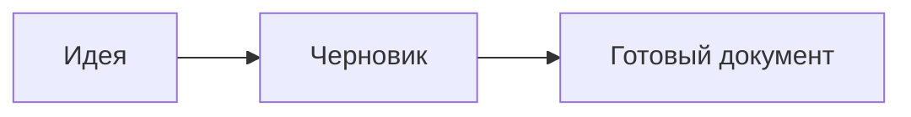

# Добро пожаловать в Typoha

Здесь можно писать **сразу с оформлением**, сохраняя документы в обычном Markdown.

## Рабочий процесс

- [x] Открыть папку с заметками
- [ ] Записать новую идею
- [ ] Поделиться готовым документом

> Документ принадлежит вам: его можно открыть в любом текстовом редакторе.

## Таблица

| Действие | Клавиши |
| --- | --- |
| Сохранить | Ctrl+S |
| Исходный код | Ctrl+/ |
| Открыть файл | Ctrl+P |
| Команды | Ctrl+Shift+P |

## Математика

$$
\int_0^1 x^2 \, dx = \frac{1}{3}
$$

## Код

```rust
fn main() {
    println!("Свои мысли — свои файлы.");
}
```

## Диаграмма


